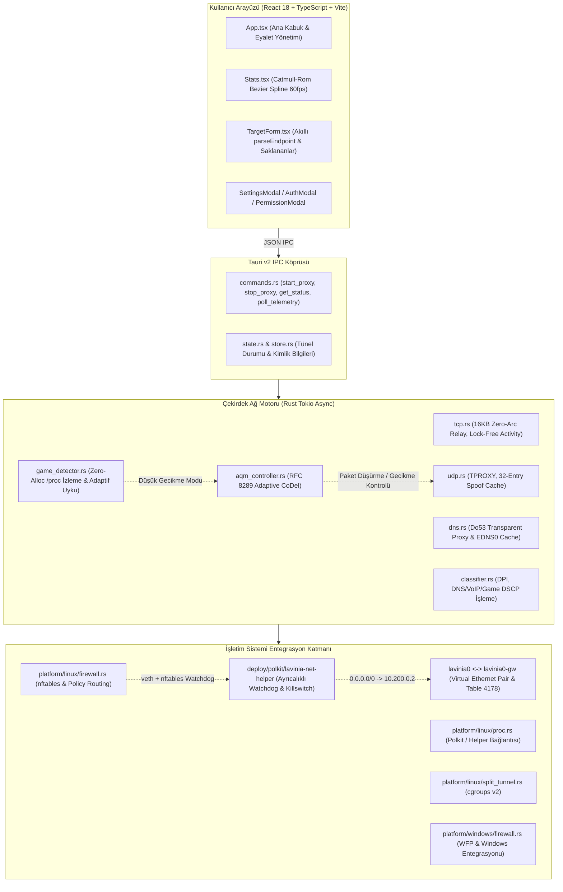

# LaviniaOS Proxy - Yeni Kaynak Kod ve Sistem Mimarisi Haritası (maps.md)

Bu belge, LaviniaOS Proxy projesinin modüler mimarisini, veri akışını, bileşen sorumluluklarını (SRP/DRY) ve dosya hiyerarşisini belgeler.

---

## 1. Mimarisi ve Veri Akış Şeması



---

## 2. Kaynak Kod Dizin ve Modül Hiyerarşisi

```text
LaviniaOS-Proxy/
├── .github/
│   └── workflows/
│       └── ci.yml                # GitHub Actions CI/CD (UI Build & Rust/C Test)
├── Cargo.toml                    # Rust workspace yapılandırması (members = ["src-tauri"])
├── LICENSE                       # Proje lisansı (MIT)
├── README.md                     # Proje dokümantasyonu, kurulum ve mimari rehberi
├── log.md                        # Optimizasyon, güvenlik ve sürüm değişiklik günlüğü
├── maps.md                       # Kaynak kod mimarisi ve dosya haritası (Bu dosya)
├── start.sh                      # Tek komutla geliştirme / başlatma betiği
├── scripts/
│   └── dev-runner.sh             # Geliştirme ortamı ön kontrol ve çalıştırma betiği
├── deploy/                       # Dağıtım, paketleme ve ayrıcalık yardımcıları
│   ├── arch/
│   │   ├── PKGBUILD              # Arch Linux paket tanımı
│   │   └── lavinia-client.install # Arch Linux kurulum sonrası setcap kancası
│   ├── linux/
│   │   └── lavinia-client.conf   # Linux paket ve CAP_NET_ADMIN yetki yapılandırması
│   ├── lavinia-client.desktop    # XDG masaüstü kısayolu (Icon=lavinia-client)
│   └── polkit/
│       ├── os.lavinia.client.policy # Polkit eylem tanımları
│       └── lavinia-net-helper    # Ayrıcalıklı firewall/killswitch/watchdog bash betiği
├── src/                          # Ön Yüz (UI) ve Alt Seviye C Veri Düzlemi
│   ├── c/                        # Yüksek performanslı C11 TUN & Lock-Free Ring Buffer
│   │   ├── include/
│   │   │   └── lavinia_tun.h     # Genel C TUN FFI başlık dosyası
│   │   ├── ring_buffer.h         # Tek üretici / tek tüketici (SPSC) halka tampon başlığı
│   │   ├── ring_buffer.c         # Lock-free SPSC halka tampon uygulaması
│   │   ├── tun_core.c            # C TUN çekirdek veri yolu ve paket işleme
│   │   └── platform/
│   │       ├── platform.h        # İşletim sistemi soyutlama başlığı
│   │       ├── linux/
│   │       │   └── tun_linux.c   # Linux /dev/net/tun (IFF_TUN | IFF_NO_PI) sürücüsü
│   │       └── windows/
│   │           └── tun_windows.c # Windows WinTUN dinamik yükleyici ve adaptörü
│   └── ui/                       # Kullanıcı arayüzü (React 18 + TypeScript + Vite)
│       ├── index.html            # Webview ana HTML şablonu
│       ├── package.json          # UI bağımlılıkları (React, Vite, Tauri API)
│       ├── tsconfig.json         # TypeScript derleme ayarları
│       ├── vite.config.ts        # Vite yapılandırması
│       └── src/
│           ├── main.tsx          # React kök montaj noktası
│           ├── App.tsx           # Ana UI kabuğu, IPC döngüleri ve modal yönetimi
│           ├── ipc.ts            # Tauri IPC komut sarmalayıcıları ve arayüz tipleri
│           ├── styles.css        # Tema sistemleri (Default, Midnight, OLED) ve stiller
│           ├── lib/
│           │   ├── format.ts     # Bayt/saniye ve paket biçimlendirme araçları
│           │   └── i18n.ts       # Türkçe / İngilizce yerelleştirme sözlüğü
│           └── components/
│               ├── Header.tsx    # Durum başlığı, ayarlar butonu ve bağlantı rozetleri
│               ├── PowerButton.tsx # Ana açma/kapatma ve bağlantı durumu butonu
│               ├── Stats.tsx     # 60 FPS Catmull-Rom Bezier telemetri grafikleri
│               ├── TargetForm.tsx # Akıllı URL ayrıştırmalı hedef proxy giriş formu
│               ├── LinkInfo.tsx  # Ağ arayüzü (Wi-Fi, USB, Eth) ve MTU bilgisi
│               ├── SettingsModal.tsx # Başlangıçta çalıştırma, DNS adblock ve tema ayarları
│               ├── AuthModal.tsx # SOCKS5 kullanıcı adı / şifre giriş modalı
│               └── PermissionModal.tsx # Polkit CAP_NET_ADMIN yetki talep modalı
└── src-tauri/                    # Rust Arka Uç ve Ağ Motoru
    ├── Cargo.toml                # Rust bağımlılıkları (tokio, tauri, socket2, libc, cc)
    ├── build.rs                  # C11 TUN kütüphanesi (liblavinia_tun.a) derleme betiği
    ├── tauri.conf.json           # Tauri v2 temel pencere, ikon ve güvenlik yapılandırması
    ├── tauri.linux.conf.json     # Linux özel paketleme kaynakları yapılandırması
    ├── tauri.windows.conf.json   # Windows özel paketleme kaynakları yapılandırması
    ├── capabilities/
    │   └── default.json          # Tauri v2 IPC yetenek ve izin bildirimleri
    ├── icons/                    # Çoklu platform uygulama ikonları (PNG, ICO, ICNS)
    ├── resources/
    │   └── bin/                  # Yardımcı ikili dosyalar için kaynak dizini
    └── src/
        ├── main.rs               # Giriş noktası (CLI argümanları veya GUI başlatma)
        ├── lib.rs                # Tauri eklenti entegrasyonu ve uygulama yaşam döngüsü
        ├── app/                  # Masaüstü kabuk entegrasyonu
        │   ├── mod.rs
        │   ├── tray.rs           # Sistem tepsisi (System Tray) menüsü ve simgesi
        │   ├── window.rs         # Pencere boyutlandırma ve görünürlük yönetimi
        │   ├── notifier.rs       # Sistem bildirimleri (Oyun modu, bağlantı uyarıları)
        │   └── glyph.rs          # Dinamik tepsi simgesi rasterizer (yeşil/turuncu/kırmızı)
        ├── engine/               # Çekirdek ağ, filtreleme ve proxy yönlendirme motoru
        │   ├── mod.rs            # Motor yaşam döngüsü ve tünel iş parçacığı yönetimi
        │   ├── tcp.rs            # Saydam TCP yönlendirme, 16KB tampon, lock-free idle
        │   ├── udp.rs            # TPROXY saydam UDP yönlendirici & spoof önbelleği
        │   ├── dns.rs            # Yerel Do53 yönlendirme, EDNS0 filtreleme & önbellek
        │   ├── socks5.rs         # SOCKS5 protokol istemcisi (RFC 1928, RFC 1929)
        │   ├── aqm_controller.rs # RFC 8289 CoDel Adaptive Queue Management kontrolcüsü
        │   ├── aqm.rs            # Çok kuyruklu DRR (Deficit Round Robin) yöneticisi
        │   ├── debloat.rs        # DSCP/TOS paket önceliklendirme matrisi
        │   ├── classifier.rs     # DPI paket sınıflandırıcı (DNS, VoIP, Gaming, Bulk)
        │   ├── bicast.rs         # Çift hat (Wi-Fi + USB) paket kopyalama ve yedekleme
        │   ├── counters.rs       # Atomik telemetri sayaçları (rx, tx, dropped, rtt)
        │   └── game_detector.rs  # Sıfır tahsisli /proc oyun algılayıcı ve adaptif uyku
        ├── platform/             # İşletim sistemi spesifik ağ ve güvenlik kodları
        │   ├── mod.rs            # Platform bağımsız arayüz tanımları (Uplink, FirewallSpec)
        │   ├── linux/
        │   │   ├── mod.rs        # Linux adaptörü (SO_ORIGINAL_DST, IP_RECVORIGDSTADDR)
        │   │   ├── firewall.rs   # nftables kuralları, MSS clamp ve watchdog
        │   │   ├── network.rs    # NetworkManager (nmcli) ve /sys donanım tespiti
        │   │   ├── proc.rs       # Ayrıcalıklı yardımcı (pkexec/sudo) yürütücü
        │   │   ├── autostart.rs  # XDG autostart .desktop dosyası yönetimi
        │   │   └── split_tunnel.rs # cgroups v2 split-tunneling yöneticisi
        │   └── windows/          # Windows adaptörü (WFP, WinTUN ve kayıt defteri)
        │       ├── mod.rs
        │       ├── firewall.rs
        │       ├── network.rs
        │       ├── proc.rs
        │       └── autostart.rs
        ├── tun/                  # C11 TUN FFI sarmalayıcısı (Fallback modu)
        │   ├── mod.rs
        │   └── ffi.rs
        └── tunnel/               # Tünel durumu ve IPC komut katmanı
            ├── mod.rs
            ├── commands.rs       # Tauri komutları
            ├── dto.rs            # IPC veri transfer nesneleri (Serde DTO)
            ├── state.rs          # Çalışma zamanı durum makinesi (Stopped, Running, Degraded)
            └── store.rs          # Konfigürasyon ve kimlik bilgileri kalıcı depolama
```

---

## 3. Bileşen Sorumlulukları ve İlkeler (SRP & DRY)

| Bileşen / Dosya | Tek Sorumluluk Prensibi (SRP) | DRY & Performans Çözümü |
| :--- | :--- | :--- |
| `aqm_controller.rs` | RFC 8289 CoDel algoritmasıyla paket gecikmesini izleyip tampon şişmesini önlemek. | Minimum sojourn süresi 100ms kayan pencereyle takip edilir; tek bir atomik fonksiyon üzerinden drop kararı verilir. |
| `tcp.rs` | İstemci TCP bağlantısını SOCKS5 upstreame sıfır kopyaya yakın aktarmak. | 16KB tampon ile `TCP_NOTSENT_LOWAT` senkronize çalışır; `split()` ile `Arc` tahsisi sıfırlanmıştır. |
| `udp.rs` | TPROXY UDP paketlerini saydam olarak yönlendirmek ve yanıtları spoof soketle geri iletmek. | Oturum başına 32 girişli `spoof_cache` ile STUN/P2P trafiğinde her paket için soket açıp kapatma syscall'ları önlenir. |
| `game_detector.rs` | Gecikmeye duyarlı oyun ve ses süreçlerini sistem kaynaklarını tüketmeden izlemek. | Önbelleklenmiş PID ile $O(1)$ kontrol, yığın üzerinde stack tamponları ve 10s adaptif uyku. |
| `lavinia-net-helper` | Yetkili ağ işlemlerini (nftables, route, cgroup) güvenli bir watchdog ile izlemek. | Pozisyonel parametreler ile komut enjeksiyonu imkansız kılınır; çökme anında fail-closed killswitch devreye girer. |
| `Stats.tsx` | Telemetriyi 60 FPS pürüzsüzlükte görselleştirmek. | Catmull-Rom kübik Bezier eğrileri ve GPU hızlandırmalı SVG linearGradient. `React.memo` ile gereksiz renderlar engellenir. |
| `TargetForm.tsx` | Kullanıcının girdiği endpoint ve proxy URL'lerini doğrulamak ve saklamak. | `parseEndpoint` ile her türlü proxy linki (HTTP, SOCKS, TG) ve kimlik bilgisi tek bir merkezden ayrıştırılır. |

---

## 4. Güvenlik ve Yetkilendirme Modeli

1. **En Az Yetki (Least Privilege)**:
   - Lavinia istemcisi normal kullanıcı haklarıyla çalışır.
   - Sadece yönlendirme ve firewall gerektiğinde Polkit üzerinden `lavinia-net-helper` çağrılır veya istemciye tek seferlik `cap_net_admin` yetkisi verilir.
2. **Fail-Closed Tasarımı**:
   - İstemci veya sistem beklenmedik bir şekilde durursa veya SIGKILL alırsa, watchdog arka planda otomatik olarak `inet lavinia_killswitch` kuralını devreye sokarak ham paket sızıntısını önler.
3. **Loopback & Yerel Ağ Yalıtımı**:
   - `127.0.0.0/8`, `::1` ve `10.0.0.0/8`, `192.168.0.0/16` yerel ağ blokları MSS sınırlamasından, transparent redirect'ten ve killswitch'ten muaf tutulur.
4. **Sanal Ethernet (`lavinia0` <-> `lavinia0-gw`) ve Politika Yönlendirmesi (Policy Routing)**:
   - Tünel aktifleştiğinde `lavinia0` (`10.200.0.1/30`, MTU `1420`) ve `lavinia0-gw` (`10.200.0.2/30`, MTU `1420`) sanal Ethernet (`veth`) çifti oluşturulur.
   - Politika yönlendirme tablosu (`table 4178`, `priority 100`) tüm sistem trafiğini (`default via 10.200.0.2 dev lavinia0`) `lavinia0` arayüzü üzerinden geçirir.
   - Upstream proxy (`$PHONE` -> `priority 50`), `SO_MARK` (`0x4c42` -> `priority 55`) taşıyan Lavinia soketleri ve yerel ağ CIDR blokları (`priority 60`) `main` tablosunda kalarak döngüye girmeden doğrudan fiziksel arayüzden (`wlan0`/`eth0`/`usb0`) çıkar.
   - `nftables` (`nat_pre`, `nat_out`, `mark_out`, `tproxy_in`, `mss_clamp`) hem yerel `output` hem de `lavinia0-gw` (`prerouting`) üzerindeki TCP, DNS ve UDP paketlerini saydam olarak Lavinia motoruna yönlendirir.

