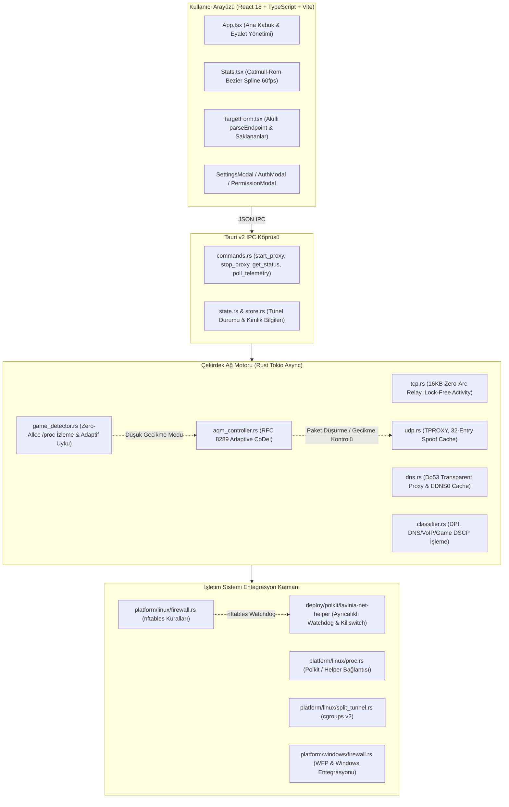

# LaviniaOS Proxy - Yeni Kaynak Kod ve Sistem Mimarisi Haritası (maps.md)

Bu belge, LaviniaOS Proxy projesinin modüler mimarisini, veri akışını, bileşen sorumluluklarını (SRP/DRY) ve dosya hiyerarşisini belgeler.

---

## 1. Mimarisi ve Veri Akış Şeması



---

## 2. Kaynak Kod Dizin ve Modül Hiyerarşisi

```text
LaviniaOS-Proxy/
├── Cargo.toml                    # Rust workspace yapılandırması
├── log.md                        # Optimizasyon, güvenlik ve sürüm değişiklik günlüğü
├── maps.md                       # Kaynak kod mimarisi ve dosya haritası (Bu dosya)
├── deploy/                       # Linux dağıtım ve ayrıcalık yardımcıları
│   ├── arch/PKGBUILD             # Arch Linux paket tanımı
│   ├── lavinia-client.desktop    # XDG masaüstü kısayolu
│   └── polkit/
│       ├── os.lavinia.client.policy # Polkit eylem tanımları
│       └── lavinia-net-helper    # Ayrıcalıklı firewall/killswitch/watchdog bash betiği
├── src/                          # Kullanıcı arayüzü (Frontend)
│   └── ui/
│       ├── package.json          # UI bağımlılıkları (React, Vite, Tauri API)
│       ├── tsconfig.json         # TypeScript derleme ayarları
│       ├── vite.config.ts        # Vite yapılandırması
│       └── src/
│           ├── main.tsx          # React kök montaj noktası
│           ├── App.tsx           # Ana UI kabuğu, IPC döngüleri ve modal yönetimi
│           ├── ipc.ts            # Tauri IPC komut sarmalayıcıları ve arayüz tipleri
│           ├── styles.css        # Tema sistemleri (Default, Midnight, OLED) ve stiller
│           ├── lib/
│           │   ├── format.ts     # Bayt/saniye ve paket biçimlendirme araçları
│           │   └── i18n.ts       # Türkçe / İngilizce yerelleştirme sözlüğü
│           └── components/
│               ├── Header.tsx    # Durum başlığı, ayarlar butonu ve bağlantı rozetleri
│               ├── PowerButton.tsx # Ana açma/kapatma ve bağlantı durumu butonu
│               ├── Stats.tsx     # 60 FPS Catmull-Rom Bezier telemetri grafikleri
│               ├── TargetForm.tsx # Akıllı URL ayrıştırmalı hedef proxy giriş formu
│               ├── LinkInfo.tsx  # Ağ arayüzü (Wi-Fi, USB, Eth) ve MTU bilgisi
│               ├── SettingsModal.tsx # Başlangıçta çalıştırma, DNS adblock ve tema ayarları
│               ├── AuthModal.tsx # SOCKS5 kullanıcı adı / şifre giriş modalı
│               └── PermissionModal.tsx # Polkit CAP_NET_ADMIN yetki talep modalı
└── src-tauri/                    # Rust Arka Uç ve Ağ Motoru
    ├── Cargo.toml                # Rust bağımlılıkları (tokio, tauri, socket2, libc)
    ├── tauri.conf.json           # Tauri v2 pencere ve güvenlik izinleri
    ├── src/
    │   ├── main.rs               # Giriş noktası (CLI argümanları veya GUI başlatma)
    │   ├── lib.rs                # Tauri eklenti entegrasyonu ve uygulama yaşam döngüsü
    │   ├── app/                  # Masaüstü kabuk entegrasyonu
    │   │   ├── mod.rs
    │   │   ├── tray.rs           # Sistem tepsisi (System Tray) menüsü ve simgesi
    │   │   ├── window.rs         # Pencere boyutlandırma ve görünürlük yönetimi
    │   │   ├── notifier.rs       # Sistem bildirimleri (Oyun modu, bağlantı uyarıları)
    │   │   └── glyph.rs          # Dinamik tepsi simgesi rasterizer (yeşil/turuncu/kırmızı)
    │   ├── engine/               # Çekirdek ağ, filtreleme ve proxy yönlendirme motoru
    │   │   ├── mod.rs            # Motor yaşam döngüsü ve tünel iş parçacığı yönetimi
    │   │   ├── tcp.rs            # Saydam TCP yönlendirme, 16KB tampon, lock-free idle
    │   │   ├── udp.rs            # TPROXY saydam UDP yönlendirici & spoof önbelleği
    │   │   ├── dns.rs            # Yerel Do53 yönlendirme, EDNS0 filtreleme & önbellek
    │   │   ├── socks5.rs         # SOCKS5 protokol istemcisi (RFC 1928, RFC 1929)
    │   │   ├── aqm_controller.rs # RFC 8289 CoDel Adaptive Queue Management kontrolcüsü
    │   │   ├── aqm.rs            # Çok kuyruklu DRR (Deficit Round Robin) yöneticisi
    │   │   ├── debloat.rs        # DSCP/TOS paket önceliklendirme matrisi
    │   │   ├── classifier.rs     # DPI paket sınıflandırıcı (DNS, VoIP, Gaming, Bulk)
    │   │   ├── bicast.rs         # Çift hat (Wi-Fi + USB) paket kopyalama ve yedekleme
    │   │   ├── counters.rs       # Atomik telemetri sayaçları (rx, tx, dropped, rtt)
    │   │   └── game_detector.rs  # Sıfır tahsisli /proc oyun algılayıcı ve adaptif uyku
    │   ├── platform/             # İşletim sistemi spesifik ağ ve güvenlik kodları
    │   │   ├── mod.rs            # Platform bağımsız arayüz tanımları (Uplink, FirewallSpec)
    │   │   ├── linux/
    │   │   │   ├── mod.rs        # Linux adaptörü (SO_ORIGINAL_DST, IP_RECVORIGDSTADDR)
    │   │   │   ├── firewall.rs   # nftables kuralları, MSS clamp ve watchdog
    │   │   │   ├── network.rs    # NetworkManager (nmcli) ve /sys donanım tespiti
    │   │   │   ├── proc.rs       # Ayrıcalıklı yardımcı (pkexec/sudo) yürütücü
    │   │   │   ├── autostart.rs  # XDG autostart .desktop dosyası yönetimi
    │   │   │   └── split_tunnel.rs # cgroups v2 split-tunneling yöneticisi
    │   │   └── windows/          # Windows adaptörü (WFP, WinTUN ve kayıt defteri)
    │   │       ├── mod.rs
    │   │       ├── firewall.rs
    │   │       ├── network.rs
    │   │       ├── proc.rs
    │   │       └── autostart.rs
    │   ├── tun/                  # Linux TUN arayüzü soyutlaması (Fallback modu)
    │   │   ├── mod.rs
    │   │   └── ffi.rs
    │   └── tunnel/               # Tünel durumu ve IPC komut katmanı
    │       ├── mod.rs
    │       ├── commands.rs       # Tauri komutları
    │       ├── dto.rs            # IPC veri transfer nesneleri (Serde DTO)
    │       ├── state.rs          # Çalışma zamanı durum makinesi (Stopped, Running, Degraded)
    │       └── store.rs          # Konfigürasyon ve kimlik bilgileri kalıcı depolama
```

---

## 3. Bileşen Sorumlulukları ve İlkeler (SRP & DRY)

| Bileşen / Dosya | Tek Sorumluluk Prensibi (SRP) | DRY & Performans Çözümü |
| :--- | :--- | :--- |
| `aqm_controller.rs` | RFC 8289 CoDel algoritmasıyla paket gecikmesini izleyip tampon şişmesini önlemek. | Minimum sojourn süresi 100ms kayan pencereyle takip edilir; tek bir atomik fonksiyon üzerinden drop kararı verilir. |
| `tcp.rs` | İstemci TCP bağlantısını SOCKS5 upstreame sıfır kopyaya yakın aktarmak. | 16KB tampon ile `TCP_NOTSENT_LOWAT` senkronize çalışır; `split()` ile `Arc` tahsisi sıfırlanmıştır. |
| `udp.rs` | TPROXY UDP paketlerini saydam olarak yönlendirmek ve yanıtları spoof soketle geri iletmek. | Oturum başına 32 girişli `spoof_cache` ile STUN/P2P trafiğinde her paket için soket açıp kapatma syscall'ları önlenir. |
| `game_detector.rs` | Gecikmeye duyarlı oyun ve ses süreçlerini sistem kaynaklarını tüketmeden izlemek. | Önbelleklenmiş PID ile $O(1)$ kontrol, yığın üzerinde stack tamponları ve 10s adaptif uyku. |
| `lavinia-net-helper` | Yetkili ağ işlemlerini (nftables, route, cgroup) güvenli bir watchdog ile izlemek. | Pozisyonel parametreler ile komut enjeksiyonu imkansız kılınır; çökme anında fail-closed killswitch devreye girer. |
| `Stats.tsx` | Telemetriyi 60 FPS pürüzsüzlükte görselleştirmek. | Catmull-Rom kübik Bezier eğrileri ve GPU hızlandırmalı SVG linearGradient. `React.memo` ile gereksiz renderlar engellenir. |
| `TargetForm.tsx` | Kullanıcının girdiği endpoint ve proxy URL'lerini doğrulamak ve saklamak. | `parseEndpoint` ile her türlü proxy linki (HTTP, SOCKS, TG) ve kimlik bilgisi tek bir merkezden ayrıştırılır. |

---

## 4. Güvenlik ve Yetkilendirme Modeli

1. **En Az Yetki (Least Privilege)**:
   - Lavinia istemcisi normal kullanıcı haklarıyla çalışır.
   - Sadece yönlendirme ve firewall gerektiğinde Polkit üzerinden `lavinia-net-helper` çağrılır veya istemciye tek seferlik `cap_net_admin` yetkisi verilir.
2. **Fail-Closed Tasarımı**:
   - İstemci veya sistem beklenmedik bir şekilde durursa veya SIGKILL alırsa, watchdog arka planda otomatik olarak `inet lavinia_killswitch` kuralını devreye sokarak ham paket sızıntısını önler.
3. **Loopback & Yerel Ağ Yalıtımı**:
   - `127.0.0.0/8`, `::1` ve `10.0.0.0/8`, `192.168.0.0/16` yerel ağ blokları MSS sınırlamasından, transparent redirect'ten ve killswitch'ten muaf tutulur.
